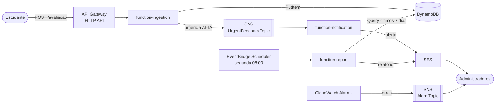

# Class Feedback System

Plataforma serverless para receber avaliações de aulas, alertar os administradores sobre avaliações críticas e enviar um relatório semanal consolidado. Projeto desenvolvido para o **Tech Challenge da Fase 4** da Pós-Tech FIAP (Arquitetura e Desenvolvimento Java).

## Descrição

Os estudantes avaliam as aulas enviando uma descrição e uma nota de 0 a 10. O sistema classifica cada avaliação por urgência, armazena tudo no DynamoDB e avisa os administradores por e-mail quando a avaliação é crítica. Toda segunda-feira, um relatório com a média das notas e as quantidades por dia e por urgência é enviado automaticamente.

A solução é composta por três funções **AWS Lambda** escritas em **Java 25 + Quarkus**, compiladas como **executáveis nativos** (GraalVM), cada uma com uma única responsabilidade. Toda a infraestrutura é declarada como código com **AWS SAM** e publicada por um pipeline do **GitHub Actions**.

## Funcionalidades

- **Registro de avaliações:** `POST /avaliacao` recebe `descricao` e `nota`; o sistema gera o id, a data de envio e a urgência.
- **Classificação por urgência:**

  | Nota | Urgência | Ação |
  |---|---|---|
  | 0 a 3 | ALTA | registrada + e-mail de alerta imediato |
  | 4 a 6 | MÉDIA | registrada |
  | 7 a 10 | BAIXA | registrada |

- **Alerta de urgência:** e-mail aos administradores (via SES) com descrição, urgência e data de envio.
- **Relatório semanal:** toda segunda-feira às 08:00 (Brasília), com média das notas, quantidade de avaliações por dia e por urgência e a lista das avaliações dos últimos 7 dias.
- **Monitoramento:** logs no CloudWatch com retenção de 14 dias e alarmes de erro que notificam os administradores por e-mail.
- **Deploy automatizado:** build nativo e deploy a cada push na branch `master`.

## Stack

| Camada | Tecnologia |
|---|---|
| Linguagem | Java 25 |
| Framework | Quarkus 3.37 (REST, Jackson, Hibernate Validator, CDI) |
| Compilação | GraalVM Native Image (build em container) |
| Computação | AWS Lambda — runtime `provided.al2023`, x86_64, 256 MB |
| API | Amazon API Gateway (HTTP API) |
| Banco de dados | Amazon DynamoDB (on-demand) |
| Mensageria | Amazon SNS |
| E-mail | Amazon SES |
| Agendamento | Amazon EventBridge Scheduler |
| Monitoramento | Amazon CloudWatch (Logs e Alarms) |
| Infraestrutura como código | AWS SAM / CloudFormation |
| CI/CD | GitHub Actions |

## Arquitetura



| Função | Gatilho | Responsabilidade |
|---|---|---|
| `function-ingestion` | API Gateway (`/avaliacao`) | Validar, classificar e gravar a avaliação; publicar as urgentes no SNS |
| `function-notification` | Tópico SNS de urgência | Enviar o e-mail de alerta aos administradores |
| `function-report` | EventBridge Scheduler (semanal) | Consolidar os últimos 7 dias e enviar o relatório |

**Organização do código:** projeto Maven multimódulo.

```
class-feedback-system/
├── common/                  # domínio compartilhado (Feedback, Urgency), contrato do evento SNS e fuso horário
├── function-ingestion/      # Lambda HTTP
├── function-notification/   # Lambda acionada por SNS
├── function-report/         # Lambda agendada
├── template.yaml            # infraestrutura (AWS SAM)
└── .github/workflows/       # pipeline de deploy
```

Cada função segue as camadas `handlers` (porta de entrada da Lambda) → `application` (casos de uso e interfaces de gateway) → `infra` (implementações com os clientes da AWS), mantendo a regra de negócio independente dos SDKs.

**Modelo de dados (DynamoDB):** `PK` = dia de envio (`yyyy-MM-dd`, horário de Brasília) e `SK` = id da avaliação. Assim, o relatório busca cada dia com uma `Query`, sem `Scan`.

**Segurança:** cada função tem uma role IAM própria, apenas com as ações necessárias (`dynamodb:PutItem`, `sns:Publish`, `dynamodb:Query`, `ses:SendEmail`) nos recursos específicos. A API tem throttling (10 req/s, burst 20), a tabela tem criptografia em repouso e Point-in-Time Recovery, e as credenciais ficam apenas nos secrets do GitHub.

## Endpoints

| Método | Rota | Descrição |
|---|---|---|
| `POST` | `/avaliacao` | Registra uma avaliação |
| `GET` | `/avaliacao` | Health check (retorna `OK`) |

### `POST /avaliacao`

**Requisição**

```json
{
  "descricao": String,
  "nota": Integer
}
```

| Status | Quando |
|---|---|
| `201 Created` | Avaliação registrada |
| `400 Bad Request` | `descricao` vazia, `nota` ausente ou fora de 0 a 10 |
| `429 Too Many Requests` | Limite de requisições da API excedido |
| `500 Internal Server Error` | Falha inesperada (ex.: DynamoDB ou SNS indisponível) |


### Disparo manual do relatório

A `function-report` não tem endpoint. Ela pode ser executada manualmente pelo console da Lambda (evento `{}`) ou pela CLI, opcionalmente com uma data de referência:

```bash
aws lambda invoke --function-name <ReportFunctionName> \
  --cli-binary-format raw-in-base64-out \
  --payload '{"referenceDate": "2026-11-16"}' out.json
```

## Configuração

### Pré-requisitos

- JDK 25
- Docker (o build nativo roda em container)
- AWS CLI configurada e AWS SAM CLI
- E-mails do remetente e dos destinatários verificados no **Amazon SES** (a conta em sandbox só envia para endereços verificados)

### Parâmetros do deploy

| Parâmetro | Descrição |
|---|---|
| `EmailSender` | E-mail remetente (identidade verificada no SES) |
| `AdminEmails` | E-mails dos administradores, separados por vírgula |
| `AlarmEmail` | E-mail que recebe os alarmes do CloudWatch |

As variáveis de ambiente das funções (`FEEDBACK_TABLE`, `URGENT_FEEDBACK_TOPIC_ARN`, `EMAIL_SENDER`, `ADMIN_EMAILS`) são preenchidas automaticamente pelo template. Para executar localmente, cada módulo tem um `.env.example` com as variáveis necessárias.

### Build nativo

```bash
./mvnw clean package -Dnative -DskipTests
```

Gera em `function-*/target/function.zip` o executável nativo de cada função, referenciado pelo `template.yaml`.

### Deploy manual

```bash
sam deploy --guided
```

Informe o nome da stack (`class-feedback-system`), a região e os parâmetros de e-mail. As respostas ficam salvas no `samconfig.toml` e os próximos deploys usam apenas `sam deploy`.

Após o primeiro deploy, confirme a assinatura do tópico de alarmes pelo e-mail **"AWS Notification - Subscription Confirmation"**.

### Deploy automatizado (GitHub Actions)

O workflow `.github/workflows/deploy.yml` roda a cada push na branch `master` (ou manualmente, em *Actions → Run workflow*): build nativo → `sam deploy`. Ele usa os seguintes secrets do repositório:

| Secret | Conteúdo |
|---|---|
| `AWS_ACCESS_KEY_ID` / `AWS_SECRET_ACCESS_KEY` | Credenciais do usuário IAM dedicado ao deploy |
| `EMAIL_SENDER` | E-mail remetente |
| `ADMIN_EMAILS` | E-mails dos administradores |
| `ALARM_EMAIL` | E-mail dos alarmes |

### Execução local

- **Modo dev (JVM):** `./mvnw -pl function-ingestion quarkus:dev`, com as variáveis do `.env.example` definidas.
- **Binário nativo:** após o build, cada módulo tem um `sam-local.yaml` para testar o executável com `sam local invoke` / `sam local start-api`.

### Remoção dos recursos

```bash
sam delete --stack-name class-feedback-system
```
